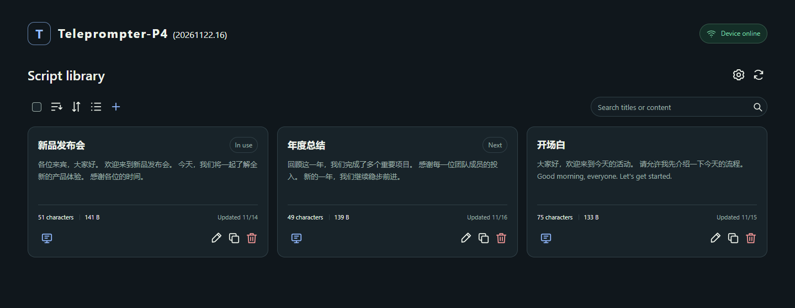
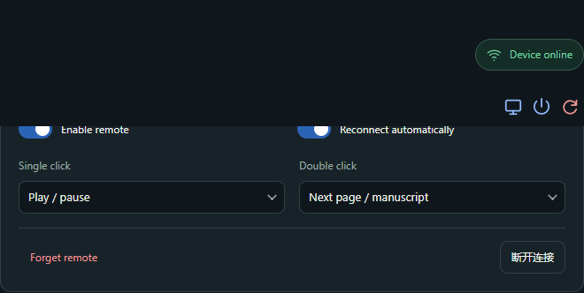
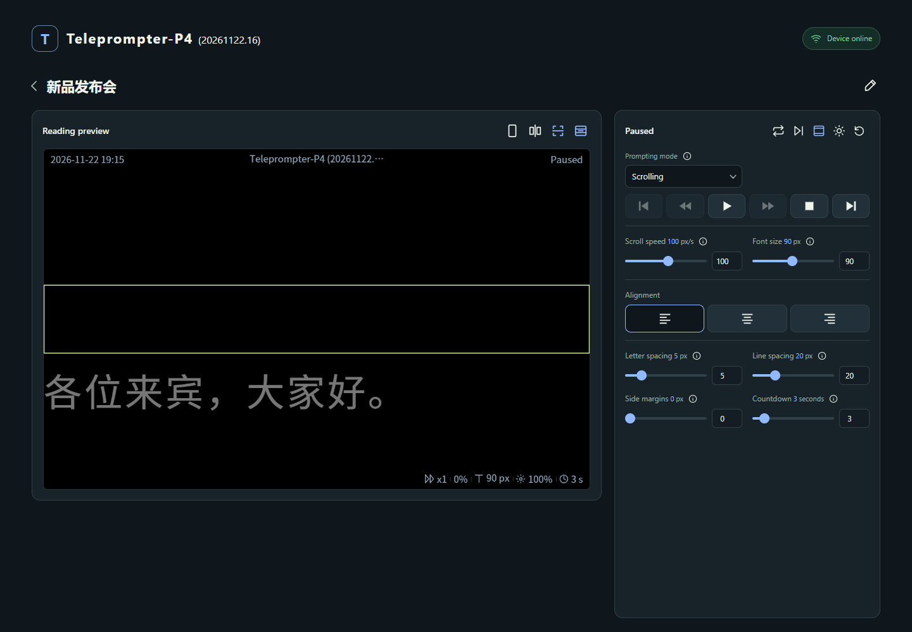
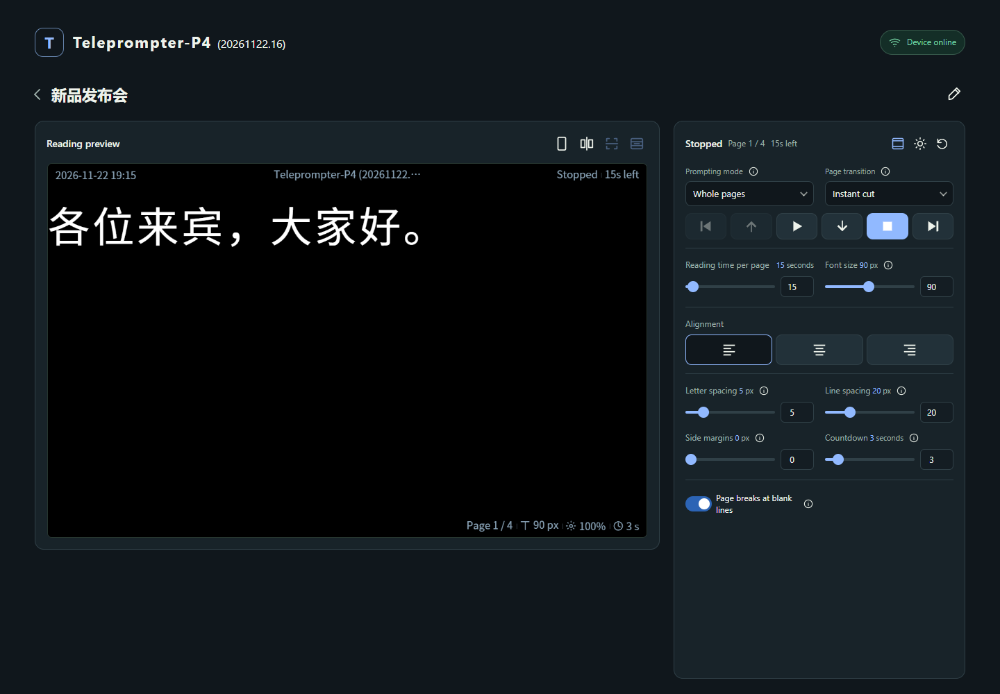
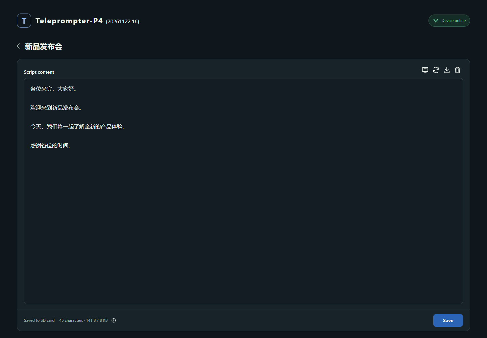
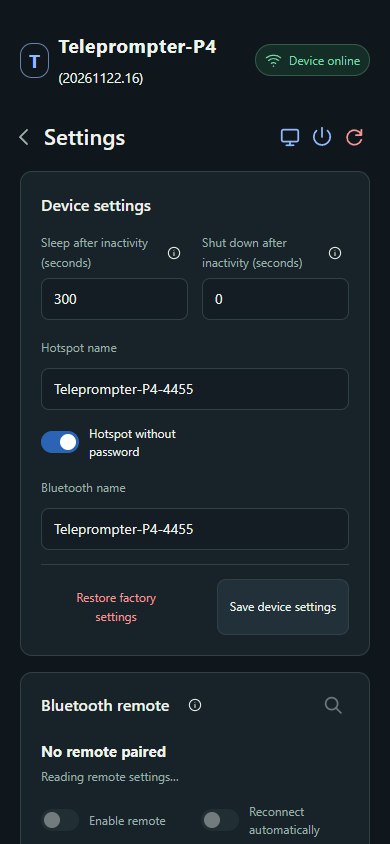
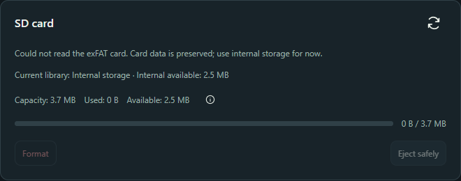
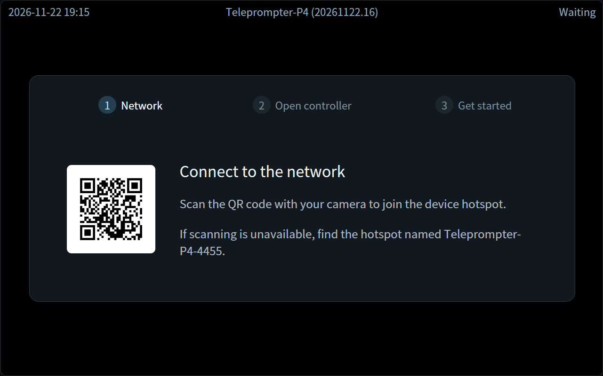
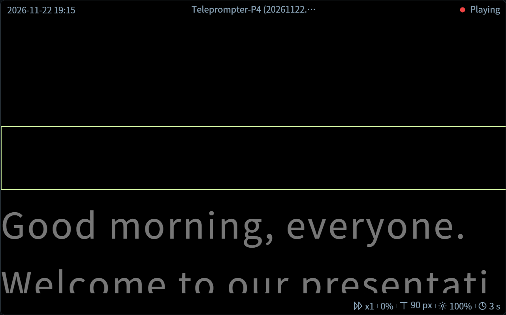
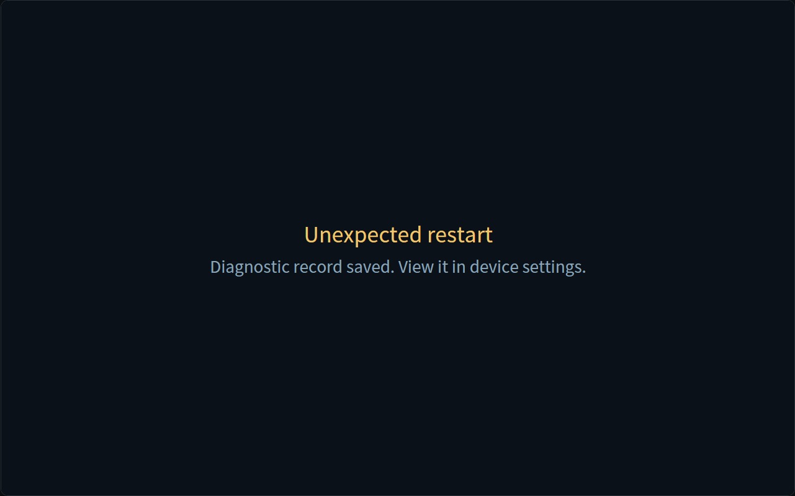

# OpenPrompt P4

[简体中文](README.zh-CN.md) · English

An ESP32-P4 teleprompter with SD and independent internal manuscript storage, a device screen and a responsive web controller. Firmware and web source live in this repository. No native Android or iOS project is included.

Version `20261122.16` supports scrolling and timed whole-page prompting, playback shortcuts and per-tab reboot recovery. The page-mode Blank-line pagination switch defaults on: blank rows between paragraphs start a new page, repeated blank rows do not create empty pages, and long paragraphs still split at screen capacity. Turn it off for continuous capacity-based pages without changing the manuscript. Saving an existing manuscript stays in the editor; a new save offers Start prompting or Home. An editor toolbar action saves changes before prompting. See the exact-image results and remaining limits in [test/handoff](docs/TEST-PLAN.md).

**New defaults:** header date and time are enabled together (timecode off), letter spacing is 5 px and initial countdown is 3 seconds. Existing saved manuscript styles and device preferences are retained.


**Storage:** exFAT and FAT12/16/32 are supported. An unavailable SD card can fall back to the independent internal library; unknown occupied internal partitions stay protected. Physical interrupted-write tests recovered in the observed phases. Occasional scrolling jitter and intermittent loading/discovery delays are not claimed eliminated; current behavior was accepted by the tester.

**Bluetooth remote:** Native P4 pairing, configurable single/double clicks and battery display. At or below20%, the web controller warns once per connection/low interval. Independent long-press actions and every remote model are not supported.



## Features

- Manuscripts as UTF-8 `.txt` files on FAT12/16/32 or exFAT SD, with optional styles and persistent order. If SD is unavailable, use an independent internal library without automatically copying or overwriting files.
- Internal storage uses the existing approximately 3.94 MiB data partition with space reserved for transactions. Unknown occupied partitions are never automatically formatted; an internal fallback cannot be guaranteed on those devices. Each manuscript remains limited to 8192 UTF-8 bytes.
- Search titles and contents; copy, edit, delete, select and reorder manuscripts.
- Wi-Fi hotspot, router LAN and Bluetooth control. The public HTTPS controller uses Web Bluetooth; the device serves the LAN controller itself.
- Scrolling or timed whole-page prompting, screen preview, orientation, glass mirror, typography, reading guides, loop and automatic advance.
- Configurable header/status bar, countdown, sleep, shutdown and connection guidance.
- Local-file, SD and online firmware updates with version, size and SHA-256 checks. A release manifest may require an update.
- Automatic browser language and light/dark theme, desktop and mobile layouts.

## Screens

These images show virtual sample data. Device screen images are simulated previews of the shared screen UI, not photographs or evidence of hardware test results.

| Screen | Preview |
| --- | --- |
| Bluetooth remote settings (virtual data) |  |
| Playback |  |
| Timed whole-page prompting |  |
| Manuscript editor |  |
| Mobile controller |  |
| Internal storage without SD |  |
| Device connection guide |  |
| Device playback |  |
| Abnormal restart recovery |  |

## Download and install

Download the current firmware ZIP from [Releases](https://github.com/0047ol/openprompt-p4/releases/latest). It includes the application image, USB boot resources, checksums and one combined test/handoff document. Release screenshots are attached to the same release.

**Hardware:** ESP32-P4 with the project's 800 × 1280 JD9365 DSI panel, 16 MB flash, PSRAM, SD and the SDIO-connected ESP32-C6 radio. Pin assignments are in `board_display.c` and `sdkconfig.idf61.defaults`. This is a board-specific firmware, not a universal P4 image. The existing C6 radio firmware is required; this project never flashes it.

For an existing installation, upload the application `.bin` through the controller, or place it under `/firmware/` on SD. Do not use bootloader or partition-table images for OTA. For USB, follow the ZIP instructions and identify the P4 ROM port; never erase the whole flash or select the C6 port.

Connect to the device hotspot, then open `http://192.168.4.1/`. Configure router Wi-Fi in device settings if desired. For Bluetooth, open the [HTTPS controller](https://0047ol.github.io/openprompt-p4/) in a browser supporting Web Bluetooth. Browsers without that API should use the device's Wi-Fi controller. No saved Wi-Fi passwords, operator credentials or private deployment endpoints are shipped in this source tree or public firmware.

## Build from source

Use Python 3 and ESP-IDF **6.1**. Install the official ESP-IDF environment, activate it, then run from the repository root:

```sh
npm --prefix tools ci
python tools/sync-web-pages.py
cd firmware/p4
idf.py -B build-idf61 -D SDKCONFIG=build-idf61/sdkconfig -D SDKCONFIG_DEFAULTS=sdkconfig.idf61.defaults build
```

Dependencies are recorded in `firmware/p4/dependencies.lock`. The ESP-IDF component manager retrieves their sources. Font assets and their licenses are included.

For the visual Demo:

```sh
python -m pip install -r web/demo/requirements.txt
python tools/build-demo.py
python -m http.server 4173 --bind 127.0.0.1 --directory web/demo/site
```

Open `http://127.0.0.1:4173/`. This is a virtual device. It does not replace hardware testing. The required-update modal can be previewed at `/console.html?update=required`.

## Capture the real device screen

Firmware 20261120.18 adds an on-demand completed-frame screenshot. It reads the actual RGB565 panel buffer, preserves UI orientation and does not wake a sleeping screen. The HTTP transfer runs outside the display/control tasks; screenshots are never polled automatically.

```sh
python tools/capture-device-screen.py --url http://DEVICE_IP --output screen.bmp
python tools/capture-device-screen.py --url http://DEVICE_IP --scale 1 --output full-resolution.png
```

The default downsample factor is 2; use `--scale 1` for every panel pixel or `--scale 4` for a smaller image. PNG conversion requires Pillow. Screenshots may contain private manuscript/network details: review them before sharing. A framebuffer capture cannot verify backlight flashes, optical appearance or motion smoothness.

## Deploy and publish

Public deployment defaults to `https://0047ol.github.io/openprompt-p4/`. To self-host, change that base URL consistently in `web/reader-font.js`, `web/firmware.js`, `tools/sync-web-pages.py`, `tools/build-demo.py` and `firmware/p4/main/teleprompter_ui.c`, then regenerate the pages and rebuild. Serve `web/hosted.html` over HTTPS, plus `web/fonts/` and published `firmware/` assets. Do not commit credentials or saved device configuration.

After changing `PROJECT_VER`, build and run `python tools/package-firmware.py`, then `python tools/package-review-firmware.py`. Publish matching source, firmware, screenshots and release notes together. See [release procedure](docs/RELEASING.md) and [test/handoff](docs/TEST-PLAN.md). Generated files come from the shared source; edit `web/controller.html`, `web/controller.css` and the individual JavaScript files.

## Current validation

The initial public build is compiled, not flashed or functionally tested. Physical scrolling may still show occasional jitter; software position checks do not establish optical smoothness. Firmware installation, required updates, copied-item feedback and physical screen rendering remain on the handoff checklist. The upstream device and private deployment must not be confused with this sanitized public build.

## License

Project-authored code is licensed under **AGPL-3.0-only**. Commercial use is allowed. Distributing modified versions requires compliance with the license, including corresponding source and prominent modification/date notices; modified software used over a network must offer its corresponding source to its users as described in section 13. This README is a summary; [LICENSE](LICENSE) is authoritative. Record modifications in [CHANGES.md](CHANGES.md).

Bundled third-party components and fonts retain their own licenses. See [THIRD-PARTY-NOTICES.md](THIRD-PARTY-NOTICES.md). No trademark rights or hardware warranty are granted.
