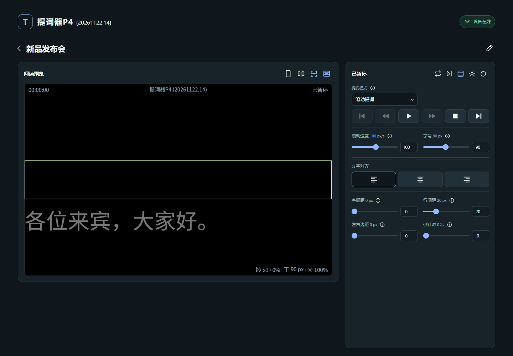
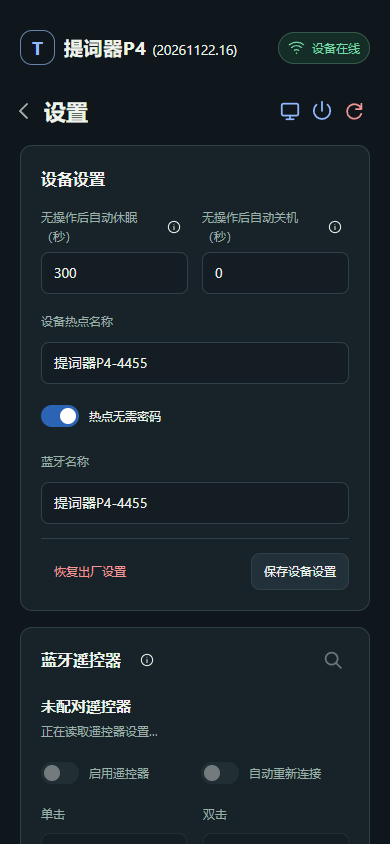
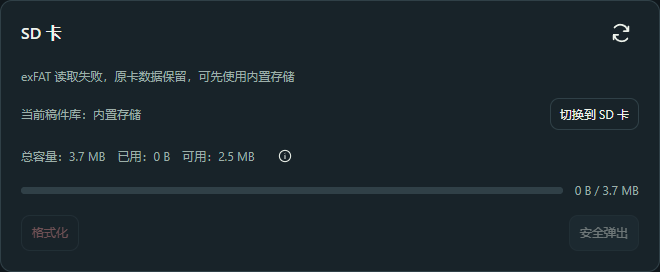
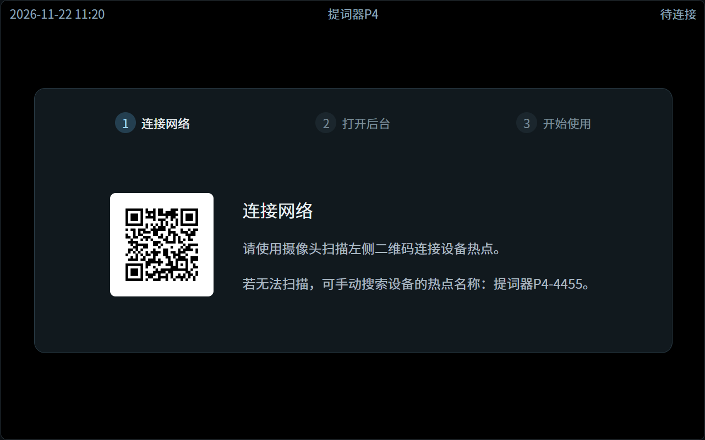
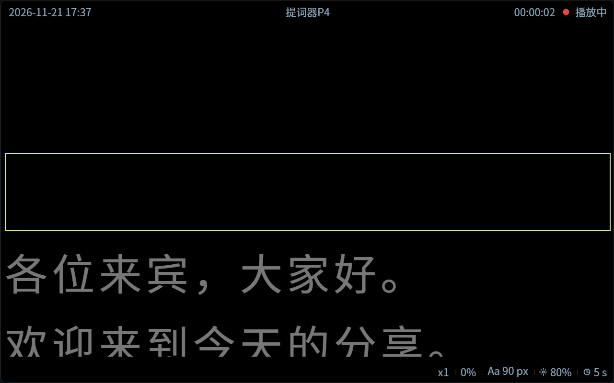

# OpenPrompt P4

简体中文 · [English](README.md)

基于 ESP32-P4 的屏幕提词器，包含 SD 与独立内置稿件库、真机显示界面和响应式网页控制台。固件与网页源码放在同一个仓库，不包含安卓或 iOS 原生项目。

`20261122.6`补齐SD/内置库双向切换按钮，只显示当前库的容量，并明确标题栏/状态栏内容设置入口。两库独立，不自动复制或覆盖。公开独立.6仅编译、未安装，见[测试交接](docs/TEST-PLAN.md)。

**存储：** 支持exFAT与FAT12/16/32，SD不可用时可切换独立内置库，继续保护未知已有分区。本轮实际写入拔卡和断电在已观察阶段恢复正常。偶发滚动抖动、冷开或蓝牙发现延迟不声称根除，当前体验已获测试者接受。


## 功能

- SD 卡存储 UTF-8 TXT 稿件，支持FAT12/16/32和exFAT、独立样式和持久化排序。SD 不可用时切到独立内置库，不自动复制或覆盖文件。
- 内置库使用现有约 3.94 MiB 数据分区，并预留事务空间；不自动格式化已有未知数据的分区，该类机器不能保证内置兜底可用。每篇仍限制 8192 UTF-8 字节。
- 标题与正文搜索、复制副本、编辑、删除、多选和拖动排序。
- 设备热点、路由器局域网、蓝牙控制。公网 HTTPS 页面通过 Web Bluetooth 连接；局域网页面由设备直接提供。
- 阅读预览、横竖屏、屏幕镜像、字号与间距、视线框、中心高亮、循环与自动下一篇。
- 可配置标题栏、状态栏、倒计时、休眠、关机和连接引导。
- 本地文件、SD 卡、在线更新，检查版本、大小和 SHA-256；服务器清单支持强制更新参数。
- 自动识别浏览器语言与明暗主题，支持电脑与手机布局。

## 界面预览

截图使用虚拟稿件与示例数据。真机屏幕图片来自共用显示逻辑的模拟预览，不是实物照片，也不代表真机测试通过。

| 界面 | 预览 |
| --- | --- |
| 播放与设置 |  |
| 移动端 |  |
| 无 SD 卡时的内置存储 |  |
| 真机连接引导模拟 |  |
| 真机播放模拟 |  |
| 异常重启恢复模拟 |  |

## 下载与使用

在 [发行版](https://github.com/0047ol/openprompt-p4/releases/latest) 下载最新固件 ZIP。包内含主应用固件、USB 刷写资源、校验信息和合并的测试交接说明；界面截图也随发行版上传。

**硬件要求：** 本项目使用 ESP32-P4、800 × 1280 JD9365 DSI 屏幕、16 MB Flash、PSRAM、SD 卡和通过 SDIO 连接的 ESP32-C6 无线模块。接线见 `board_display.c` 和 `sdkconfig.idf61.defaults`。这是指定硬件的固件，不适用于所有 P4 开发板。C6 需要已具备匹配的无线协处理器固件，本项目不刷写 C6。

已有设备可在控制台上传主应用 `.bin`，或放到 SD 卡 `/firmware/` 目录更新。不要把 bootloader、分区表用作 OTA。USB 安装按 ZIP 说明识别 P4 ROM 端口，不清空整片 Flash，不刷 C6。

连接设备热点后打开 `http://192.168.4.1/`，可在设备设置配置路由器 Wi-Fi。蓝牙控制请在支持 Web Bluetooth 的浏览器访问 [HTTPS 控制台](https://0047ol.github.io/openprompt-p4/)；不支持的浏览器可使用设备 Wi-Fi 页面。公开源码与公开固件不包含私人服务器地址、操作凭据或已保存的 Wi-Fi 密码。

## 源码构建

准备 Python 3 与官方 ESP-IDF **6.1**，激活 IDF 环境后在仓库根目录执行：

```sh
python tools/sync-web-pages.py
cd firmware/p4
idf.py -B build-idf61 -D SDKCONFIG=build-idf61/sdkconfig -D SDKCONFIG_DEFAULTS=sdkconfig.idf61.defaults build
```

组件版本由 `firmware/p4/dependencies.lock` 记录，IDF 组件管理器会下载对应源码。字体资源及其许可证已经包含。

界面 Demo：

```sh
python -m pip install -r web/demo/requirements.txt
python tools/build-demo.py
python -m http.server 4173 --bind 127.0.0.1 --directory web/demo/site
```

访问 `http://127.0.0.1:4173/`。Demo 使用虚拟设备，不能替代硬件验收。强制更新弹窗预览入口为 `/console.html?update=required`。

## 获取真机截图

20261120.18 起可按需截取已经提交的真实 RGB565 屏幕帧，自动还原横竖屏；息屏时取黑帧，不会唤醒屏幕。传输在独立任务中执行，平时不自动轮询截图。

```sh
python tools/capture-device-screen.py --url http://设备IP --output screen.bmp
python tools/capture-device-screen.py --url http://设备IP --scale 1 --output full-resolution.png
```

默认缩小为二分之一；`--scale 1` 保留原尺寸全部像素，`--scale 4` 可减少传输量。PNG 转换需安装 Pillow。截图可能包含私人稿件或网络信息，分享前请检查。帧缓存截图不能证明背光不闪屏、屏幕实际色彩或动画流畅。

## 部署与发布

公开部署地址默认为 `https://0047ol.github.io/openprompt-p4/`。自行部署时，统一修改 `web/reader-font.js`、`web/firmware.js`、`tools/sync-web-pages.py`、`tools/build-demo.py` 和 `firmware/p4/main/teleprompter_ui.c` 中的基地址，再生成网页并编译。HTTPS 服务同时放置 `web/hosted.html`、`web/fonts/` 和已发布的 `firmware/` 资源。不要提交密码或已保存的设备配置。

修改 `PROJECT_VER` 后构建，运行 `python tools/package-firmware.py` 和 `python tools/package-review-firmware.py`。源码、固件、截图与说明应对应同一发行版。参阅 [发布流程](docs/RELEASING.md) 与 [测试交接](docs/TEST-PLAN.md)。网页应修改共享源文件，不手动修改生成页面。

## 当前验证状态

初次公开版本仅完成编译，没有刷入或功能实测。真机滚动仍可能偶发抖动；软件位置没有倒退不代表肉眼流畅。固件安装、强制更新、复制占位、真机显示等均列入待测清单。脱敏公开版与私人部署版具有不同部署地址，不混淆二者的测试结论。

## 开源协议

本项目自行编写的代码采用 **AGPL-3.0-only**，允许商用。分发修改版本时须遵守协议，包括提供对应源码、保留声明并显著注明修改及日期；修改版通过网络提供服务时，按第 13 条向用户提供对应源码。本段为概述，以 [LICENSE](LICENSE) 全文为准。修改记录写入 [CHANGES.md](CHANGES.md)。

第三方组件和字体继续适用各自许可证，见 [THIRD-PARTY-NOTICES.md](THIRD-PARTY-NOTICES.md)。不授予商标权，不承诺硬件保修。
